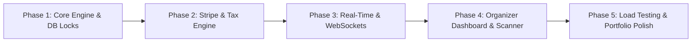

# FlashTicket Engine — Architecture Specification & Portfolio Blueprint
**Target Audience:** Senior Engineering Hiring Managers & Technical Leads (Canada / US Tech Market)  
**Role Positioning:** Senior Full Stack Engineer (Laravel / React / High-Throughput & Distributed Systems)

---

## 1. Executive Summary & Value Proposition

**FlashTicket Engine** is an enterprise-grade, high-concurrency event ticketing platform modeled after systems like Ticketmaster, Eventbrite, and DICE. It is designed to handle high-demand "flash sales" where thousands of concurrent checkout requests compete for a finite inventory of tickets within milliseconds.

### Why this demonstrates Senior Engineer Competency
1. **Concurrency & Race Conditions:** Demonstrates mastery of distributed locking (Redis Redlock), pessimistic database locks (`SELECT ... FOR UPDATE`), and idempotent webhook/checkout flows. Zero overselling.
2. **High-Performance Architecture:** Sub-millisecond inventory reads via Redis Caching + Invalidation strategies, background asynchronous ticket minting via queues, and batch processing.
3. **Enterprise Domain-Driven Design (DDD) / Modular Monolith:** Clean separation of concerns with Actions, Services, Repositories, DTOs, and Form Requests rather than bloated controllers.
4. **Canadian & North American Market Compliance:** Multilingual (English / Canadian French - i18n), multi-currency (CAD / USD), tax compliance (GST / PST / HST calculation engine), and accessibility compliance (WCAG 2.1 AA / AODA compliant UI).
5. **Modern Full-Stack Stack:** Laravel 11/12, React 19 / TypeScript, Inertia.js, Tailwind CSS v4, shadcn/ui, Redis, PostgreSQL/MySQL, Stripe Checkout, and Docker.

---

## 2. Target Tech Stack & Engineering Standards

| Layer | Technology | Justification |
| :--- | :--- | :--- |
| **Backend Framework** | Laravel 11 / PHP 8.3+ | Expressive syntax, robust queue engine, strict typing, typed properties |
| **Frontend Architecture** | React 19 + TypeScript + Inertia.js | SPA experience without decoupled API overhead; type-safe page contracts |
| **Styling & Components** | Tailwind CSS v4 + shadcn/ui (Radix) | Accessible, lightweight, zero-runtime CSS, fully responsive mobile-first |
| **In-Memory Cache & Locks** | Redis (Cluster-ready) | Fast stock counters, atomic decr/incr operations, distributed locking |
| **Primary Database** | PostgreSQL 16 (or MySQL 8.0 with InnoDB) | ACID compliance, JSONB support, row-level locking (`FOR UPDATE`) |
| **Queue & Worker Engine** | Laravel Horizon + Redis Queues | Asynchronous PDF generation, email dispatches, ticket release daemons |
| **Payment Gateway** | Stripe Connect / Payment Intents | Idempotent payments, 3D Secure, webhooks with signature verification |
| **Real-time Engine** | Laravel Reverb (WebSockets) | Live inventory countdowns, reservation TTL tick-down, waiting room queue |
| **Testing Suite** | Pest PHP + PHPUnit + Playwright | 90%+ code coverage, end-to-end checkout concurrency testing |
| **DevOps & Containers** | Docker, Docker Compose, GitHub Actions | Multi-stage production container builds, CI/CD pipeline, automated linting |

---

## 3. Core Functional Requirements & Domain Modules

### 3.1. High-Throughput Reservation & Inventory Engine
* **Atomic Pre-Hold:** When a user selects $N$ tickets and initiates checkout, the system places a hold on inventory for 10 minutes (`expires_at`).
* **Two-Tier Reservation Strategy:**
  1. *Fast-Path (Redis):* Atomic decrement via Redis Lua scripts to filter out excess requests before hitting the relational database during peak spikes.
  2. *Durable-Path (Database):* Transactional lock (`lockForUpdate()`) to create the `Reservation` record with an auto-expiring TTL.
* **Automatic Expiration Daemon:** Scheduled job / Redis Key Expiration (Keyspace Notifications) or Horizon queue that cleans up expired `pending` reservations, instantly restoring availability to other buyers.
* **Idempotency Safeguard:** Idempotency key per reservation session preventing duplicate bookings on double-clicks or unstable connections.

### 3.2. Events & Multi-Tier Ticketing Management
* **Hierarchical Structure:**
  * `Event` $\rightarrow$ belongs to an Organizer / Venue.
  * `TicketTier` (e.g., General Admission, VIP Early Bird, Balcony) with distinct price, max per order, sales start/end times.
* **Dynamic Statuses:** `Draft`, `Published`, `Sold Out`, `Paused`, `Archived`.
* **Dynamic Seating / General Admission:** Support for standing general capacity as well as tiered quotas.

### 3.3. Payment & Checkout Pipeline
* **Stripe Checkout / Elements Integration:**
  * Secure, PCI-compliant card collection with Apple Pay / Google Pay support.
  * Webhook listener with replay-attack protection, verification signature, and transaction wrappers.
* **North American Tax Calculation Engine:**
  * Automatic calculation of Canadian taxes: GST (5%), PST (BC 7%, SK 6%, MB 7%), or HST (ON 13%, Atlantic 15%) based on customer billing postal code.
* **Order Transition Lifecycle:**
  `Reservation (Pending)` $\rightarrow$ `Payment Processing` $\rightarrow$ `Order Confirmed` $\rightarrow$ `Tickets Dispatched`.
  *(In case of failure/cancellation: `Reservation Cancelled` $\rightarrow$ `Inventory Restored`).*

### 3.4. Ticket Generation & Check-In System (QR Code)
* **Digital Ticket Issuance:**
  * Unique cryptographically signed hash/UUID for each ticket.
  * Secure dynamic QR Code (incorporating HMAC expiration to prevent screenshot duplication/fraud).
* **PDF Ticket Generator:** Asynchronous background job generating PDF tickets (via Spatie Browsershot or DomPDF) with event banner, seat info, and QR code.
* **Organizer Scanner / Check-In Web App:**
  * Camera-based QR Code scanner page (HTML5 QR Scanner / ZXing).
  * Real-time gate validation (`Valid`, `Already Used at 19:42`, `Invalid Ticket`).

### 3.5. Real-Time Virtual Waiting Room (Queue-IT style)
* When concurrent users exceed a threshold (e.g., > 500 requests/sec for a specific event), users are placed in a virtual waiting room powered by Redis Sorted Sets (`ZADD` / `ZRANK`).
* Real-time position polling/WebSocket update: *"You are #42 in line. Estimated wait: 1 minute."*

### 3.6. User Roles & Multi-Tenancy (RBAC)
* **Attendee:** Browse events, hold reservations, checkout, download tickets, view purchase history.
* **Event Organizer:** Dashboard with real-time revenue analytics, tier management, gate attendee check-in stats.
* **Platform Admin:** Platform-wide oversight, dispute resolution, fee commission management (e.g., 5% application fee on gross sales).

---

## 4. UI/UX, Design System & Accessibility (WCAG 2.1 AA)

### 4.1. Design Philosophy
* **Sleek, High-Conversion Dark/Light Interface:** Inspired by Linear, Stripe, and Apple. Minimalist, uncluttered, typography-focused (Inter / Geist font).
* **Responsive / Mobile-First:** 100% responsive across mobile (390px iPhone viewport up to 4K ultra-wide monitors).
* **Micro-Interactions & State Polish:**
  * Live countdown timer on reservation (`09:59` remaining to pay).
  * Skeleton loaders, optimistic UI updates, animated progress bars for sold-out percentages.
  * Non-blocking toast notifications (Sonner / Radix Toast).

### 4.2. Internationalization (Canada Focus)
* Fully integrated multi-language support (English & French Canadian - `en-CA` / `fr-CA`).
* Currency toggle & formatting (`CAD $` and `USD $`).

---

## 5. Non-Functional, Security & Performance Requirements

| Metric / Requirement | Target Specification |
| :--- | :--- |
| **Response Time (p95)** | $\le 120\text{ ms}$ for event view, $\le 250\text{ ms}$ for reservation creation |
| **Concurrency Load** | Simulated 1,000 requests/sec with 0 over-allocations |
| **Database Isolation Level** | Read Committed with explicit pessimistic row locks on reservation transactions |
| **Security Standards** | OWASP Top 10 hardened, strict CSP headers, Rate Limiting (Throttle Middleware), CSRF protection |
| **Code Quality** | PHPStan Level 8/max, Pest PHP test coverage $\ge 85\%$, ESLint + Prettier + Strict TypeScript |
| **Accessibility** | WCAG 2.1 Level AA compliant (accessible contrast ratios, full keyboard navigation, ARIA roles) |

---

## 6. Project Architecture & Directory Structure

```text
flashticket-engine/
├── app/
│   ├── Actions/                  # Single-responsibility business actions
│   │   ├── Checkout/             # ProcessStripePaymentAction, CalculateTaxesAction
│   │   ├── Inventory/            # AcquireTicketLockAction, ReleaseExpiredReservationsAction
│   │   └── Tickets/              # GenerateTicketPdfAction, ValidateQrCodeAction
│   ├── DataTransferObjects/      # Spatie/Custom typed DTOs (e.g., ReservationData, CheckoutData)
│   ├── Enums/                    # ReservationStatus, EventStatus, TicketStatus, TaxProvince
│   ├── Http/
│   │   ├── Controllers/          # Thin controllers delegating to Actions/Services
│   │   ├── Requests/             # Form Requests with strict validation rules
│   │   └── Resources/            # Inertia / API JSON Resource transformers
│   ├── Models/                   # Eloquent models with typed properties & relationships
│   ├── Services/                 # Orchestration services (ReservationService, StripePaymentService)
│   └── Jobs/                     # Asynchronous jobs (ReleaseExpiredReservationJob, DispatchTicketsJob)
├── resources/
│   └── js/
│       ├── components/           # Reusable Radix/Tailwind components (Button, Modal, CountdownTimer)
│       ├── layouts/              # AppLayout, AuthLayout, OrganizerDashboardLayout
│       ├── pages/                # Inertia Pages
│       │   ├── events/           # Show.tsx, Index.tsx (Catalog)
│       │   ├── checkout/         # ReservationTimer.tsx, PaymentForm.tsx
│       │   ├── tickets/          # MyTickets.tsx, TicketDetail.tsx (QR display)
│       │   └── organizer/        # Analytics.tsx, CheckInScanner.tsx
│       └── types/                # Generated TypeScript definitions for backend models
├── tests/
│   ├── Feature/                  # Concurrency tests, Race-condition simulations, Stripe webhook tests
│   └── Unit/                     # Tax calculation tests, Service isolated tests
└── docker/                       # Dockerfile, docker-compose.yml, nginx configuration
```

---

## 7. Phased Implementation Roadmap for Portfolio



### Phase 1: Robust Concurrency & Inventory Lock (Week 1)
- [x] Basic models: `Event`, `TicketTier`, `Reservation`, `Ticket`.
- [ ] Implement Redis-backed atomic stock countdown + fallback to PostgreSQL `lockForUpdate()`.
- [ ] Scheduled background worker (`ReleaseExpiredReservations`) with event broadcast.
- [ ] Write concurrency feature tests in Pest PHP using parallel processes (`artisan test --parallel`).

### Phase 2: Checkout, Taxes & Stripe Integration (Week 2)
- [ ] Integrate Stripe Elements with 3D Secure verification.
- [ ] Build Canadian Sales Tax calculation service (`GST/PST/HST` by province).
- [ ] Idempotent Webhook handling (`checkout.session.completed`, `payment_intent.payment_failed`).
- [ ] Asynchronous Ticket PDF generator dispatching to user email.

### Phase 3: Real-time UI & Reservation Experience (Week 3)
- [ ] Build high-converting Event page with live tier availability indicators.
- [ ] Reservation checkout screen with live SVG countdown clock and auto-release warnings.
- [ ] Implement WebSockets via Laravel Reverb for instant "Sold Out" badge pushes without page refreshes.

### Phase 4: QR Code Check-in App & Organizer Portal (Week 4)
- [ ] Organizer revenue and conversion metrics chart (using Recharts).
- [ ] Mobile-optimized camera scanner (`/organizer/events/{id}/scan`) to validate attendee tickets.
- [ ] Bilingual switch (`EN-CA` / `FR-CA`).

### Phase 5: Senior Polish, Stress Testing & Showcase Assets (Week 5)
- [ ] Execute `k6` or `Artillery` load test simulating 10,000 concurrent tickets requests to prove zero race conditions.
- [ ] Production-ready `docker-compose.yml` (App, Postgres, Redis, Horizon, Reverb).
- [ ] Top-tier GitHub `README.md` with architectural diagrams, load-testing benchmarks, and Loom video walkthrough.

---

## 8. What Canadian & Global Recruiters Look For
* **Clean Git History:** Meaningful commit messages following Conventional Commits (`feat: ...`, `fix: ...`, `perf: ...`).
* **Automated CI/CD:** GitHub Actions running Pest, PHPStan (Level 8+), and TypeScript checks on every pull request.
* **Zero Technical Debt in Documentation:** Clear setup instructions (`./vendor/bin/sail up` or single-step script) with seeders containing rich fake data.
* **Demonstrated Architectural Reasoning:** Explicitly explaining *why* choices were made (e.g., pessimistic locks vs optimistic locks vs Redis Redlock).

