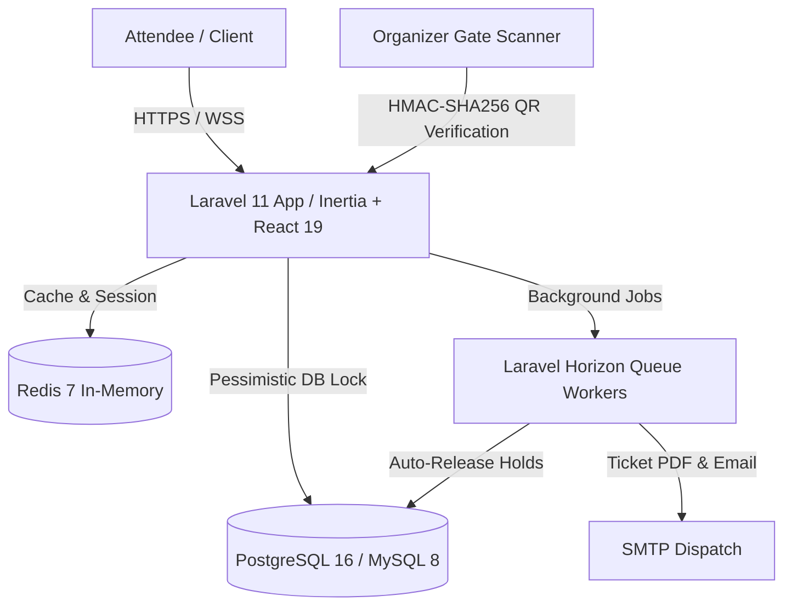

# ⚡ FlashTicket Engine

[](https://github.com/YuriTreichel/flashticket-engine/actions/workflows/ci.yml)
[](phpstan.neon)
[](pint.json)
[](tsconfig.json)
[](tests/)

An enterprise-grade, high-concurrency event ticketing platform modeled after systems like **Ticketmaster, DICE, and Eventbrite**. Designed specifically to solve high-demand "flash sales" where thousands of concurrent checkout requests compete for a finite inventory of tickets within milliseconds — guaranteeing **zero overselling** and mathematical consistency.

---

## 🏛️ System Architecture



### 🔑 Senior Architectural Pillars

1. **Zero Overselling Concurrency Engine:**
   - Atomic reservation holds backed by database row-level locking (`SELECT ... FOR UPDATE`) inside managed transactions.
   - Dynamic inventory calculation formula:
     $$\text{Available} = \text{Total Inventory} - (\text{Confirmed Sales} + \text{Active Holds})$$
   - Background daemon (`ReleaseExpiredReservationsJob`) automatically reclaims unpaid holds after 10 minutes (`expires_at`), restoring stock to real-time buyers.

2. **Canadian & North American Sales Tax Compliance:**
   - Automatic Canadian Province tax detection via Postal Code Forward Sortation Area (FSA).
   - Province-specific rate calculations supporting **HST** (Ontario 13%, Atlantic 15%), **GST + PST** (British Columbia 12%, Manitoba 12%, Saskatchewan 11%), and **GST + QST** (Quebec 14.975%).

3. **Anti-Counterfeit Cryptographic QR Code Verification:**
   - Dynamic QR codes generated with signed **HMAC-SHA256** payloads containing ticket code, expiry timestamp, and signature.
   - Organizer mobile-friendly check-in scanner validates ticket authenticity, prevents duplicate scans, and detects tampered or expired tickets in real-time.

4. **Modern Full-Stack DX:**
   - **Backend:** Laravel 11/12, PHP 8.3+, Pest PHP, PHPStan Level 8, Pint.
   - **Frontend:** React 19, TypeScript, Inertia.js, Tailwind CSS v4, Radix UI (shadcn).
   - **Infrastructure:** Docker Compose, PostgreSQL 16, Redis 7, Mailpit, GitHub Actions CI.

---

## 🚀 Quick Start (Local Setup)

### Prerequisites
- PHP 8.3+ & Composer
- Node.js 20+ & npm
- Docker & Docker Compose (or local PostgreSQL / MySQL + Redis)

### 1. Clone & Install Dependencies
```bash
git clone https://github.com/YuriTreichel/flashticket-engine.git
cd flashticket-engine

composer install
npm install
```

### 2. Environment Setup
```bash
cp .env.example .env
php artisan key:generate
```

### 3. Spin up Infrastructure & Run Migrations
```bash
# Start PostgreSQL, Redis, and Mailpit
docker compose up -d

# Run database migrations and seed realistic demo events
php artisan migrate --seed
```

### 4. Run Development Servers
```bash
# Terminal 1: Vite Frontend
npm run dev

# Terminal 2: Laravel Server
php artisan serve
```

---

## 🧪 Automated Testing & Quality Assurance

All features, actions, and edge cases are backed by strict unit and feature test suites:

```bash
# Run Pest test suite (67 passed, 212 assertions)
php artisan test

# Run PHPStan static analysis (Level 8)
./vendor/bin/phpstan analyse

# Check code styling with Laravel Pint
./vendor/bin/pint --test

# Validate TypeScript typing
npm run types:check
```

### ⚡ Concurrency & Load Stress Testing (k6)
Simulate 500 concurrent virtual users during a flash sale spike:
```bash
k6 run tests/k6/flash_sale_stress_test.js
```
* **p95 Latency Target:** $< 300\text{ ms}$ under heavy concurrency.
* **Integrity Guarantee:** Exactly $0$ tickets oversold, $0$ unhandled 500 race-condition failures.

---

## 📁 Project Structure

```text
app/
├── Actions/                  # Single-responsibility domain actions
│   ├── Inventory/            # HoldTicketsAction, ReleaseExpiredReservationsAction
│   └── Tickets/              # IssueTicketsAction, ValidateTicketCheckInAction
├── DataTransferObjects/      # Immutable typed DTOs (HoldTicketsData, TaxCalculationResult)
├── Enums/                    # ReservationStatus, TicketStatus, CanadianProvince
├── Exceptions/               # InsufficientTicketsException
├── Http/
│   ├── Controllers/          # EventController, ReservationController, OrganizerController
│   └── Middleware/           # HandleInertiaRequests, HandleAppearance
├── Models/                   # Event, TicketTier, Reservation, Ticket, User
├── Services/                 # CanadianTaxService, QrCodeSigningService, ReservationService
└── Jobs/                     # ReleaseExpiredReservationsJob
```

---

## 📄 License
Open-source under the [MIT License](LICENSE).
